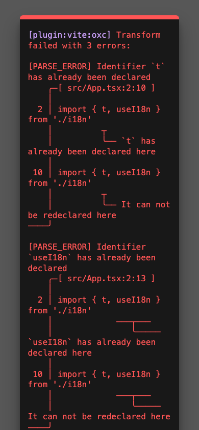
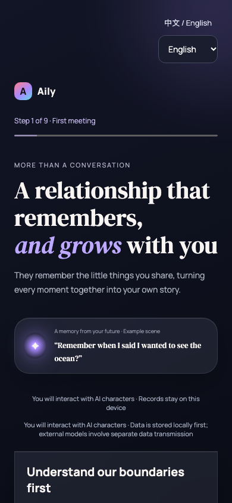

# Blank-screen startup repair

## Before

Baseline: `51cea1096f7f7c8f69f04e9c24122380a544fdf6` (`main` at ticket start).



Actual Chromium capture of the unchanged application at `/`, 390 × 844 CSS pixels, device scale 1, dark color scheme, Asia/Shanghai timezone, default English browser language, fresh isolated browser storage. The Vite development error overlay reports duplicate `t` and `useI18n` bindings; the application root has zero children. The overlay is real application-serving output, not a fabricated previous UI. Its absence in a production build does not mean the app would render: the baseline TypeScript build fails before producing a deployable bundle.

## After

Changed revision: the source commit containing this document and `after.png` (the PR description pins its exact commit).



Same route, viewport, device scale, theme, timezone, default English browser language and fresh-storage state. Application renders its existing first onboarding step and disclosure; no redesign or bypass of consent. Both images were inspected after capture.

## Verification

- Baseline `npm run build`: failed with duplicate imports, unresolved sharing/nickname symbols and merged context-call argument errors.
- Final `npm test`: 50 files, 721 tests passed.
- Final `npm run build`: passed. Existing advisory: a minified JavaScript chunk exceeds 500 kB; this is not a build failure.
- `CAPTURE=1 node scripts/verify-startup.mjs`: passed against isolated Vite dev server on port 4399. Checks fresh startup, returning-user synthetic local fixture, populated memories, existing sharing dialog, all five tabs, local demo reply and reload, with no browser errors.
- Production `vite preview` on port 4400: actual Chromium fresh onboarding and reload both passed without browser errors.
- No real API key, private conversation data or external model call is used by the browser verification.

Reproduce dev verification with:

```sh
npm run dev -- --host 127.0.0.1 --port 4399 --strictPort
CAPTURE=1 node scripts/verify-startup.mjs
```

The regression script deliberately uses a separate browser context. It never resets the user's browser profile or stored data.
