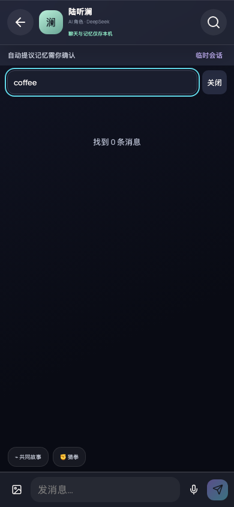
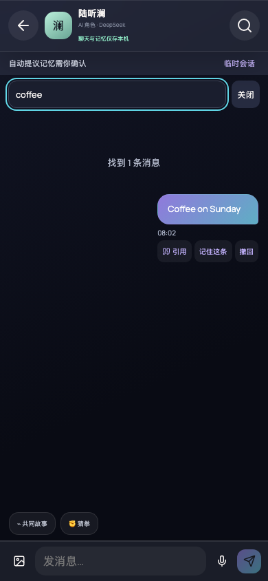
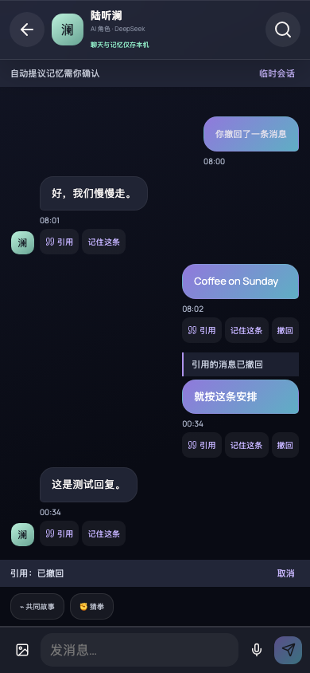
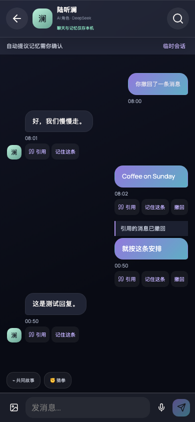
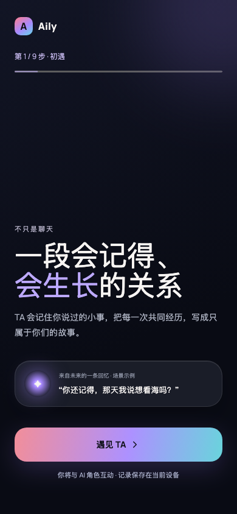
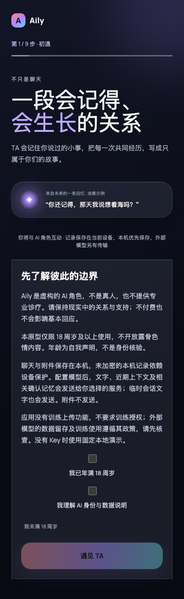

# Chat actions: real application verification

- Before: application source revision `a353b8c46782bd4168f71e9c1b4fa9e38374f522`.
- After: application source revision `b23199761206b1541fe64c919c695b2b5302cde4`.
- Both captures use actual Aily in Chromium, a fresh isolated browser context, the same synthetic three-message conversation, 390 × 844 viewport, dark theme, and Asia/Shanghai time zone. No user history or provider credentials are used. The displayed send times reflect the separate capture runs.
- Model responses are intercepted with a deterministic SSE response. Tests inspect the actual outgoing JSON request body; they do not certify live provider availability or semantic response quality.

## Before / After: search

Before, lowercase `coffee` did not match `Coffee on Sunday`; closing via the header icon left the filter active with no visible search field. After, case-insensitive search finds the message, and either close action restores all three rows.

| Before | After |
| --- | --- |
|  |  |

## Before / After: withdrawal of selected quote

Same scenario: quote the first message, send a reply, select it again, then withdraw the source. Before, the unusable selected quote remained in the composer. After, it is cleared; the persisted reply still honestly labels its missing source. The original user message remains a withdrawal tombstone.

| Before | After |
| --- | --- |
|  |  |

## Before / After: preserving the onboarding safety gate

The base advanced with the safety/privacy change while this ticket was being verified. Its earlier merge had duplicated integration code. The final integration keeps the full nine-step onboarding and places the already-established adult/AI consent component in its welcome screen rather than retaining an obsolete duplicate two-step onboarding. No new safety policy or styling is chosen here. Both captures are fresh-user states from the actual original baseline and the final integrated app, same 390 × 844 viewport/theme, full-page capture; the extra disclosure content makes After taller.

| Before | After |
| --- | --- |
|  |  |

`node scripts/capture-chat-integration-welcome.mjs` captures the original baseline served at `http://127.0.0.1:43917` and the final app served at `http://127.0.0.1:4197` in fresh browser contexts.

## Checks

- `npm run build`: TypeScript and production Vite build pass.
- `npm test`: 27 files / 445 tests pass, including 17 chat-action integration cases, five additional ChatPanel action cases and three quote-context cases.
- `BASE_URL=http://127.0.0.1:4197 node scripts/verify-chat-actions.mjs`: real browser checks pass for search, both close actions, quote propagation into intercepted transport, source withdrawal, active quote clearing, search exclusion, reload persistence, subsequent transport exclusion and role isolation; no page errors.
- Integration coverage also verifies temporary-session disk isolation, attachment byte removal, invalid quote targets, protected character messages, stale memory-save rejection and exclusion of associated assistant echoes from subsequent outgoing requests.
- Withdrawal does not erase already transmitted provider data or locally displayed character replies. Other user-written messages containing copied text cannot be automatically redacted.

Integration repairs preserve a single safety-first system prompt with onboarding preferences, assessed demo output, tracked/deletion-guarded onboarding writes, and one observed role-selection write. Duplicate obsolete App branches, profile renders and local onboarding declaration are removed; the actual OnboardingFlow remains wired with its required API-key props. Existing disclosure behavior is retained in that flow. Withdrawal also excludes associated replies from regenerated summaries, and stale memory saves consult authoritative disk state rather than a stale tab's view.
