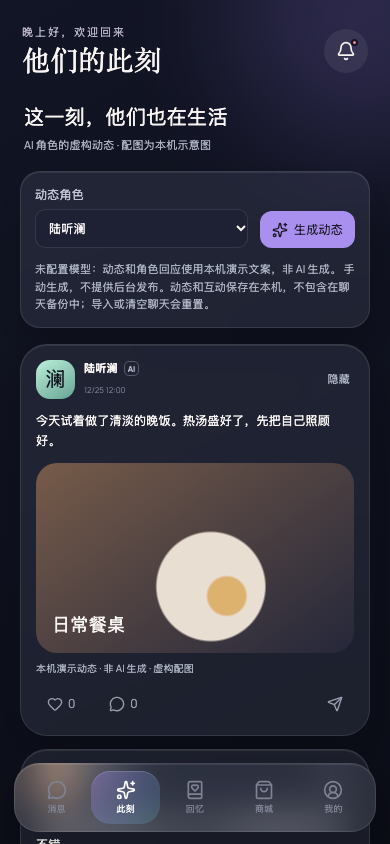
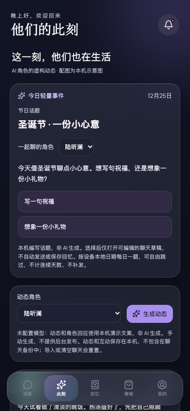

# Daily and holiday events — actual application evidence

## Revisions and matching scenario

- **Before:** `ec96cdf73352e0b31bdccd897ca5f65d6a9a9ec8`, existing feed after prerequisite startup/merged-contract restoration, before daily-event integration. Original `e2b3527` cannot render the application because App/onboarding localization imports are missing. The prerequisite commit repairs those imports and restores existing chat contracts; it does not add the daily card or change the feed layout.
- **After:** `d66ed8609a7299a0f59e06d7ec86b87afcdcb554`, daily-event implementation. Evidence-only documentation commits do not change this UI.
- Both captures use the real Vite application, an isolated onboarded browser fixture, selected role Lu Tinglan, Chinese interface, dark theme, reduced motion, 390 × 844 viewport, scale 1, Asia/Shanghai device time zone and **2026-12-25 12:00 local time**, on the same Moments page. No user conversations, API keys or private source content are used.

## Before



## After



## Additional scenarios

- [Editable Gu Chenze draft without sending](after-draft.png)
- [Next local day switches to the daily rotation](after-daily.png)
- [English card at 320px, no horizontal overflow](after-english-320.png)

The surrounding feed retains its pre-existing Chinese interface; only the new event card is bilingual here. These screenshots do not claim to fix existing application-wide localization gaps.

## Verification

```bash
npm run build
npx vitest run src/DailyEventCard.test.tsx src/dailyEvents.test.ts src/MomentsScreen.test.tsx
BASE_URL=http://127.0.0.1:4537 node scripts/verify-daily-events.mjs
```

Build and all 30 focused tests pass. The catalog's 14 tests additionally pass under UTC, Asia/Shanghai and America/New_York. Browser verification checks holiday selection, correct-role editable draft without creating user messages, refresh stability, open-page date rollover, live English switching and 320px layout. The card never sends a model request or writes memories/progress.

The full repository suite is not green: the final branch has 599 passing and 22 failing tests. The independent repaired baseline has 581 passing and the exact same 22 failing tests across the same eight test files (603 total). The final branch adds 18 passing tests, with no new failing titles. Both baseline and final production builds pass; this comparison does not represent the full suite as green. Remaining failures concern pre-existing onboarding/consent fixtures, app-wide localization, exclusive nicknames/demo recall, stream completion handling and story/chat integration; the new daily topic does not repair those paths. Production build reports the existing bundle-size warning.

## Prototype boundaries

Seven curated daily topics repeat on a calendar-day rotation; four fixed Gregorian holidays replace that day's topic. No lunar-calendar mapping, inferred local weather, remote editorial console, scheduled publication, notifications, streaks, catch-up or paid unlocks. Topic catalog changes ship with an application revision. Choices are editable drafts in the existing chat flow; sending and any later memory confirmation remain explicit user actions.
