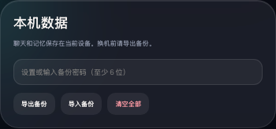
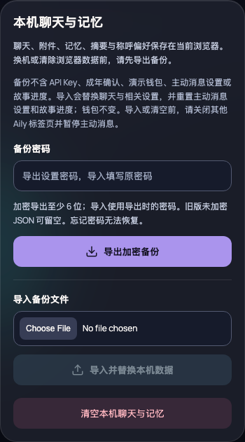
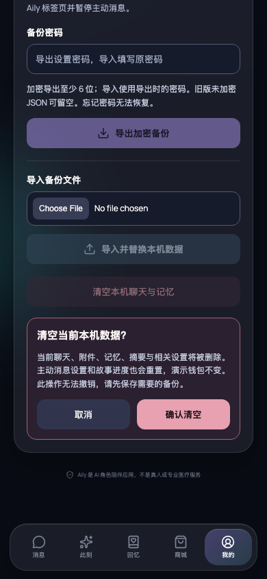

# 数据导入 / 导出：实际应用视觉证据

## 对比版本与场景

- **Before — `76527a69d79875f8343f61f0da469490cd6b37f2`**：保留原有数据工具界面，仅先修复入口中重复的合并片段，使应用能够运行。原始主分支 `af0e1c8` 存在编译错误，无法直接进入 Profile；此处不是原始主分支可正常运行的声明，也不是绘制的 mockup。
- **After — `a7dd0738e7eae50396ee9f8eb7abcc656842cd8b`**：可用的数据导出 / 导入面板及本地读取失败重试。
- 两者均为本地运行的实际 Aily 应用，隔离浏览器上下文，已进入体验 → 我的 → 数据工具；深色主题，390 × 844 CSS 像素，1× DPR，减弱动画，Asia/Shanghai 时区，密码为空、未选文件、无提示、未展开 API 设置。只使用测试消息，不含真实用户资料或凭据。
- 卡片截图采用相同 350px 宽度，完整保留各版本卡片高度；整页截图使用相同 viewport。Before 的备份区仍使用旧有 8–9px 控件，而 After 使用可读标签、独立文件选择与 44px 操作目标。

## Before

[Before：完整 Profile](before-profile.png)

## After

[After：完整 Profile](after-profile.png)

[After：320 × 740 窄屏 Profile](after-profile-320.png)

## 验证

`node scripts/verify-data-transfer.mjs` 使用真实 Chromium、Web Crypto、下载与 IndexedDB 验证：

- 密码不足时不导出；加密 JSON 下载，不含明文测试消息。
- 取消导入不写库；错误密码保留旧记录，可直接使用同一文件重试。
- 下载的加密备份可重新导入并保留原消息。
- 无效 JSON 不覆盖旧数据；旧版未加密 v1 JSON 可留空密码导入。
- 清空可取消；确认后删除聊天并回到引导。
- 320px 页面无水平溢出；全流程无浏览器运行时错误。

`npm test`：28 个测试文件、437 个测试通过，包括 15 个面板测试与 2 个真实 App/IndexedDB 刷新失败回归测试。`npm run build` 与 `git diff --check` 通过。

## 范围与限制

没有改变备份格式、密码算法或数据库导入事务。导入/清空调用现有数据准备检查，它不是跨标签页排他锁；界面明确提示关闭其他 Aily 标签页并暂停主动消息。数据已提交但刷新失败时，界面显示资料可能尚未更新及“重试读取”，不再错误地声称未覆盖记录。下载提示表示发起下载，不承诺用户已保存文件。
