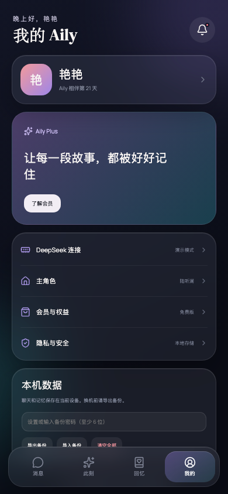
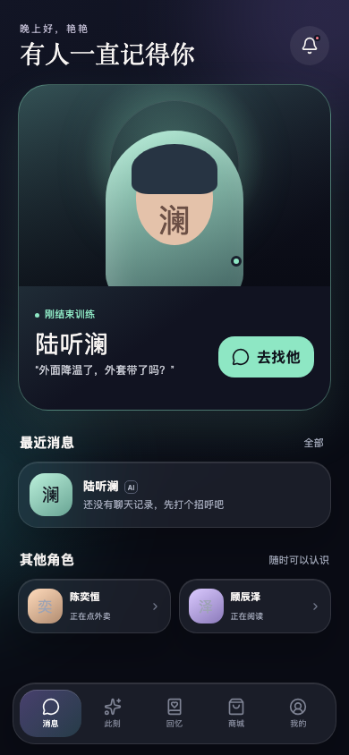
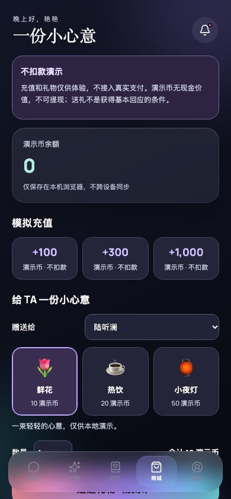
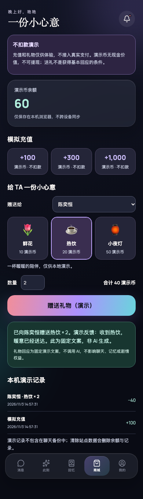
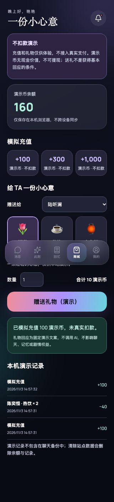

# 商城演示视觉证据

## 可比较场景

- **Before 应用基线**：`e764cce5587f3ce5645737ce2be940905d3f4f5a`，PR #2 的真实可运行应用，在独立 worktree 启动。
- **After UI 修订**：`29c67c7d6685cc4ae0b4869b619429c009ef925e`；后续证据提交仅加入本目录，不更改 UI。
- 两版均为 Chromium、390×844、deviceScaleFactor 1、深色主题、减弱动态；隔离空白浏览器上下文，首次引导选择陆听澜后打开“我的”和“消息”。没有真实聊天、密钥或私人会话内容。
- 两版首页及个人页是**相同场景**。旧应用没有商城页，不伪造旧商城截图；新版商城和送礼成功截图是额外的真实交互证据。

### Before — `e764cce`




### After — `29c67c7`




### 新版演示交互（非 Before/After 配对场景）







## 重现与验证

```bash
# 基线应用在4176端口启动后，捕获Before：
AILY_URL=http://127.0.0.1:4176/ node scripts/verify-gift-demo.mjs --before
# 当前应用在4175端口启动后，验证并捕获After：
node scripts/verify-gift-demo.mjs
```

脚本验证余额不足不写入、充值、键盘取消、确认后的焦点恢复、礼物/角色/数量、固定演示回应、记录、刷新保留、数量校验、另一标签页实时同步、320px无横向溢出。每次创建隔离浏览器上下文，不修改使用者已有数据。不调用真实支付或模型服务。
