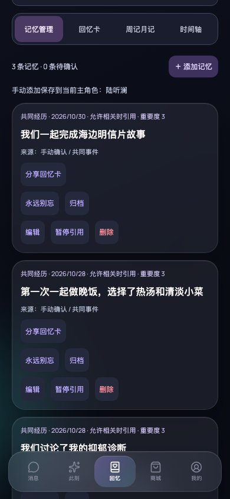

# 月度回忆册：真实应用视觉证据

## 场景和版本

- **Before**：未修改的 `main`，`f01ab5c35ab304accb34bd9786852ab5da3e68dd`，独立 worktree 的真实应用。
- **After**：本 PR 分支 `agent/monthly-memory-album-80841f9cd6c3` 合并上述主线后的月度回忆册实现；PR 描述标明准确 head revision。
- 相同场景：已完成引导、陆听澜、回忆页、全部分类、无搜索；滚动使回忆视图切换条顶部距视口 20px。
- 相同 390 × 844 视口、深色主题、Asia/Shanghai 浏览器时区。应用月份明确使用 UTC 确认时间。
- 仅注入合成测试数据：2026-10 两件普通共同经历、一件敏感经历和一件其他角色经历。无私人聊天、照片或凭据。

## Before

## After

新入口的月份、条目选择与默认隐私模式：

实际对外文字预览与检查确认：

## 验证和重现

`node scripts/verify-monthly-album.mjs` 使用真实 Chromium 验证角色隔离、敏感条目排除、默认无原文、确认后实际下载、可选摘录、未改写原记忆、320 / 768 宽无横向溢出及无页面异常。新功能使用真实应用截图，不是设计稿。

`AILY_PHASE=before-current BASE_URL=http://127.0.0.1:4322` 在未修改的上述主线捕获 Before。After 默认访问本分支的 `http://127.0.0.1:4321`。脚本只应在测试实例运行，因为它会替换该 origin 的本机数据。

自动化测试覆盖默认不导出个人内容、显式摘录与额外词语脱敏、UTC 分月、记忆生命周期过滤、失效预览、导出时到期复查、隐私设置保存期间禁止导出、分享取消/失败、下载 URL 清理和中英文新界面。自动脱敏仍不保证匿名；必须检查预览。系统分享面板的真实外部送达未自动验证，浏览器下载与 Web Share 调用契约分别由真实浏览器及单元测试验证。

## 历史基线（非本次主比较）

开始工作时 `main` 为 `e2b3527bc978f9e1f1375dcac293ac95cc2ddd73`，遗漏 App 的 `t` / `useI18n` 导入，启动实际报 `useI18n is not defined`。保留[原始启动失败截图](before-memories.png)与[仅补上 App 导入的真实回忆页](before-repaired-memories.png)作为调查证据，后者不是未修改基线。主线随后合入分享功能并修复相关合并缺失，本 PR 合并新主线后重新捕获以上未修改 Before 和最终 After，不以历史修复基线代替最终比较。
