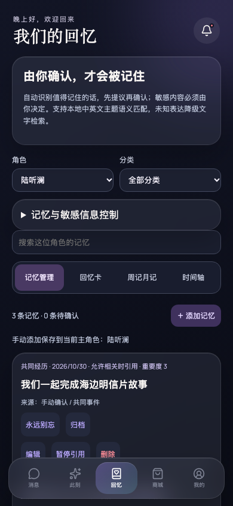
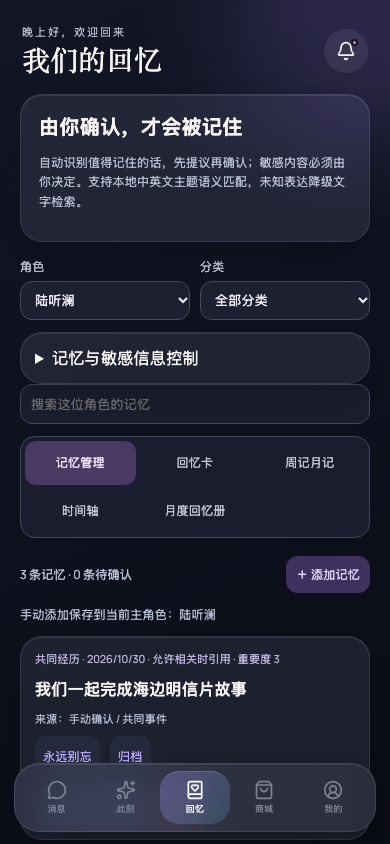
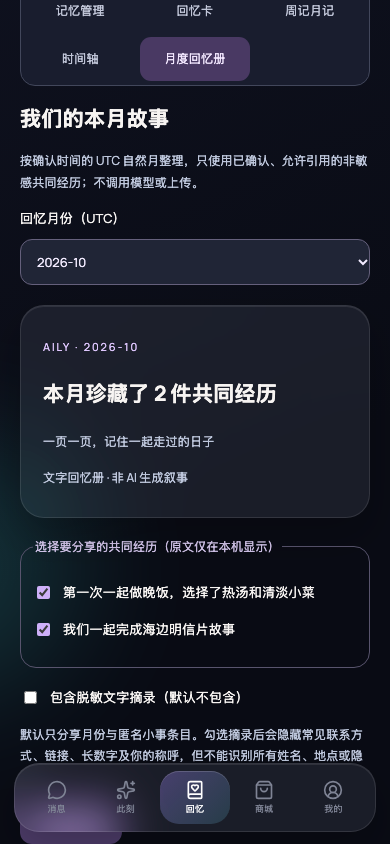
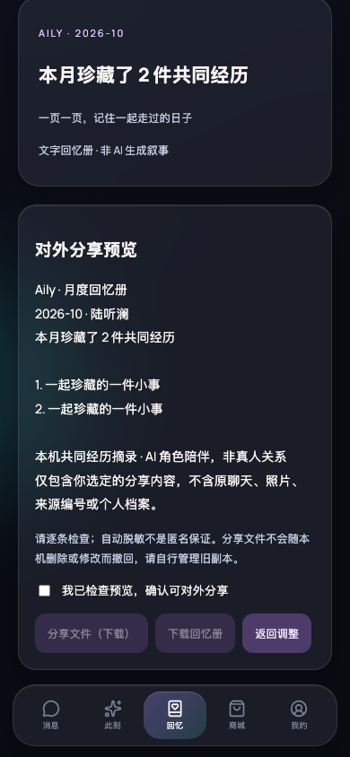

# 月度回忆册：真实应用视觉证据

## 场景和版本

- 固定场景：已完成引导、角色陆听澜、回忆页、全部分类、无搜索。仅注入合成测试数据：2026-10 两件普通共同经历、一件敏感经历和一件其他角色经历。无私人聊天、照片或凭据。
- 相同视口 390 × 844、深色主题、Asia/Shanghai 浏览器时区；应用月份规则明确使用 UTC。
- **Before（原始基线）**：`e2b3527bc978f9e1f1375dcac293ac95cc2ddd73`。该版本遗漏 App 的 `t` / `useI18n` 导入，实际启动时报 `useI18n is not defined`，因此真实截图为空白背景，不能假称它是可工作的旧界面。
- **Before（可比基线，明确包含启动修复）**：同一基线的独立 worktree，仅在 App 第一行后加入 `import { t, useI18n } from './i18n'`。无月度回忆册代码，使用真实应用和相同数据、页面状态捕获原有四个回忆入口。这是启动修复后的比较，不是未修改基线或设计稿。
- **After**：本 PR `agent/monthly-memory-album-80841f9cd6c3` 的月度回忆册实现；PR 描述标明准确 head revision。回忆页同场景截图用于直接比较，回忆册与预览截图补充展示新功能。

## Before

原始基线启动失败：

仅修复启动导入后的真实回忆页（可比基线）：

## After

相同回忆页、筛选和数据：

新入口的月份、条目选择与默认隐私模式：

实际对外文字预览与检查确认：

## 验证

`node scripts/verify-monthly-album.mjs` 使用真实 Chromium 应用验证角色隔离、敏感条目排除、默认无原文、确认后实际下载、可选摘录、未改写原记忆、320 / 768 宽无横向溢出及无页面异常。

`AILY_PHASE=before` 在未修复原始基线上捕获启动失败；`AILY_PHASE=before-repaired BASE_URL=http://127.0.0.1:4322` 在仅修复 App 导入的独立基线上捕获可比页面。After 默认访问本分支的 `http://127.0.0.1:4321`。脚本只应在测试实例运行，因为它会替换该 origin 的本机数据。

自动化测试覆盖默认不导出个人内容、显式摘录与额外词语脱敏、UTC 分月、记忆生命周期过滤、失效预览、导出时到期复查、隐私设置保存期间禁止导出、分享取消/失败、下载 URL 清理和中英文新界面。自动脱敏仍不保证匿名；必须检查预览。系统分享面板的真实外部送达未自动验证，浏览器下载与 Web Share 调用契约分别由真实浏览器及单元测试验证。
