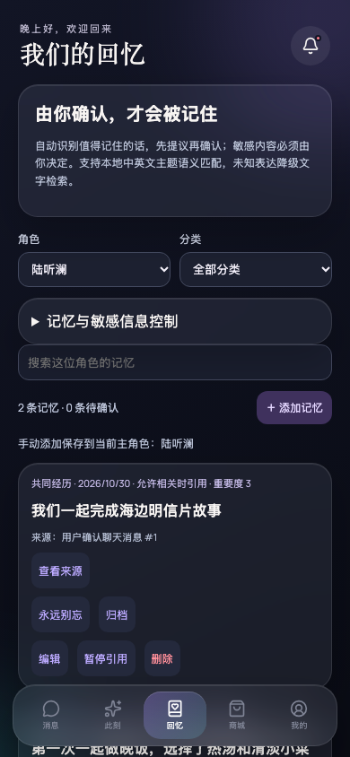
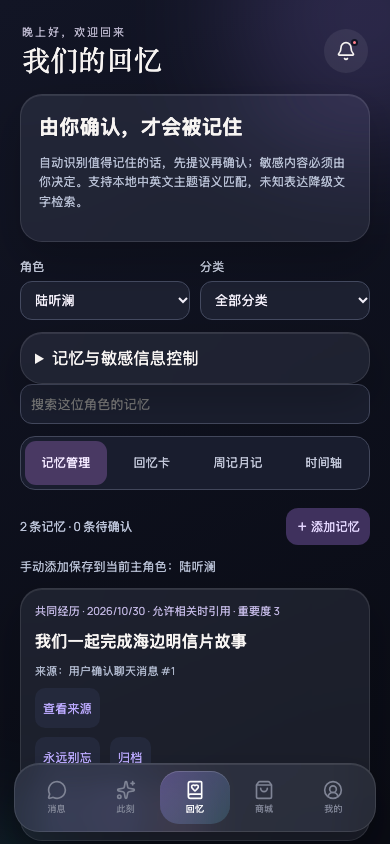
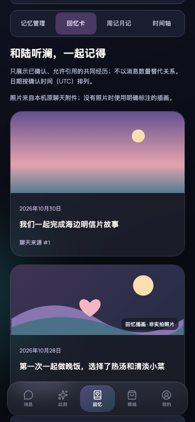
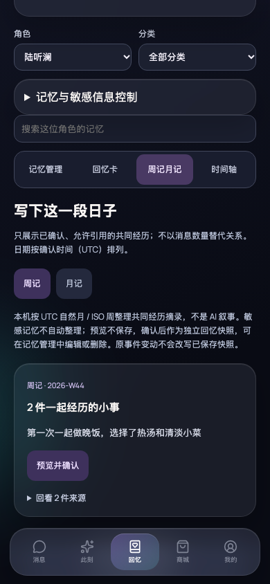
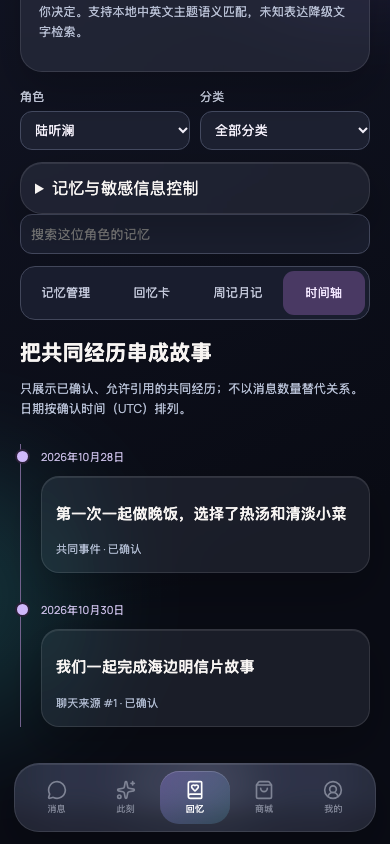

# 关系回忆视图：实际应用视觉对比

## 捕获条件与版本

- Before：`49b77b846e2ff47474b16e365b37ea5671298bb9` 的原有回忆页面。上游 `af0e1c8f1a5fc538957ba3d0e3c64b7119c05a2e` 带有重复函数／循环／返回对象，不能启动；仅合并这些重复路径后捕获真实旧页面，未修改回忆 UI。不是重绘的旧版模型图。
- After：`4faad5940466e77ddd8784be8afbdf5fec859f3e`。
- 对比场景完全相同：实际 Vite 应用、“回忆”入口、陆听澜、全部分类、空搜索、相同两件已确认共同事件及本机图片附件；另有陈奕恒事件用于验证隔离。
- 浏览器 viewport：390 × 844，deviceScaleFactor 1，dark，Asia/Shanghai。页面顶部 Before / After 为同尺寸截图；新增视图补充图为同尺寸 viewport 下滚动至主要内容后的实际页面截图。
- 示例图片由脚本生成并作为真实聊天附件写入隔离测试数据库，不是真人／用户照片；所有文字和数据都是合成测试夹具，不含私有聊天、凭据或模型服务数据。

## Before

原页面仅显示记忆管理列表。

## After

同一页面增加回忆卡、周记月记和时间轴切换，保留管理控件。

### 图文回忆卡

原聊天图片附件与共同经历文字一起展示。无附件的事件显示明确标注的插画。

### 周记／月记

共同事件摘录先预览，只有再次确认才保存为独立回忆快照。此图展示确认前的草稿状态。

### 关系时间轴

已确认共同事件按确认时刻从早到晚展示；没有消息累计数字或伪造事件。

## 验证

`npm run build` 通过；`npm test` 31 个测试文件、487 个测试通过（整合同期主分支的数据导入导出、朋友圈功能后再次全量验证）。

`node scripts/verify-relationship-memories.mjs` 在隔离 Chromium 上下文验证：照片、角色隔离、事件顺序、预览取消不写入、周／月确认保存、刷新及备份往返保留、删除源事件移除卡片、已确认快照独立保留、320 / 768 宽度无水平溢出，且无浏览器运行时错误。单元／集成测试另覆盖敏感与暂停／归档／到期排除、UTC 偏移排序、跨年 ISO 周、失败重试、过期草稿拒绝，以及保存期间页面视图／角色／应用底部导航锁定。

说明：日期为 UTC 确认日期，非真实事件发生日期；周记月记为本机摘录，非模型叙事。源事件变更不自动改写已确认快照，删除信息时需同时管理快照与旧备份。其他角色可浏览，保存前须切换为当前主角色。
