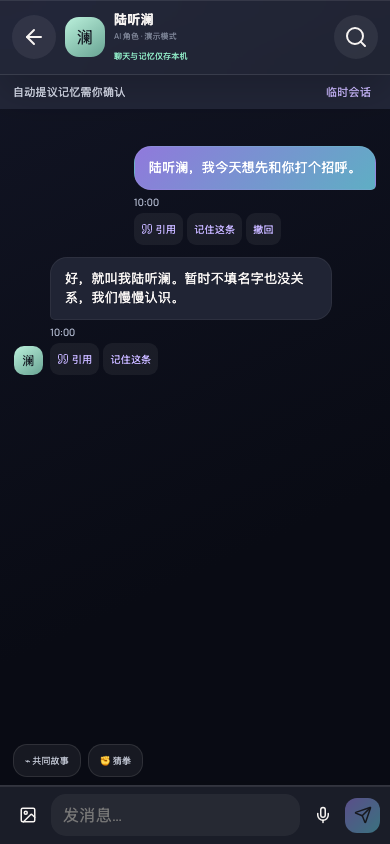
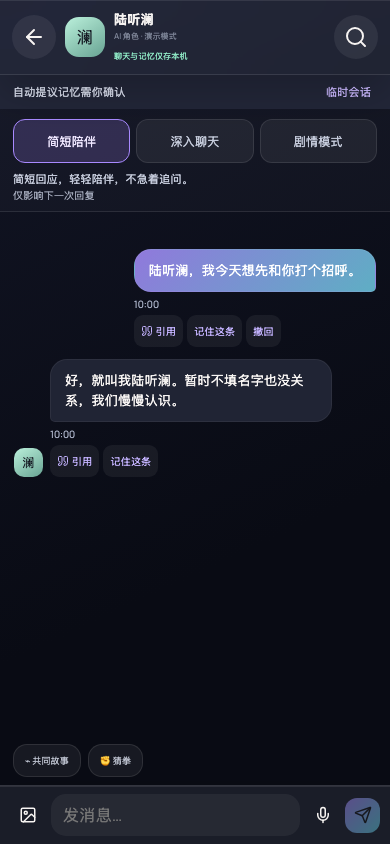
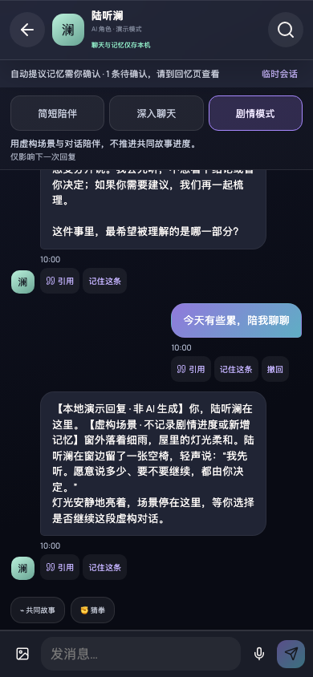
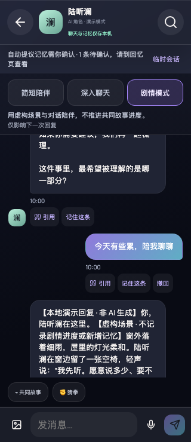

# 回复模式：真实应用视觉验证

## 版本与场景

- **Before**：`5f4bd8f55c4237efdd465fc9a178af38cf5d3ace`，回复模式功能加入前的真实应用。原始基线 `d156203` 含重复合并片段，无法通过 TypeScript 解析，并重复计算引导保存锁；先移除这些阻止启动的片段，未加入模式控件或改变聊天样式，再捕获此可运行基线。
- **After**：`1d0aad789dfcb4139e87838ca74cc583b713ae02`，完成回复模式实现和验证后的应用。后续证据提交仅加入本说明与截图，不修改应用代码。
- 同一场景：完成默认首次引导后进入陆听澜聊天，只有两条称呼试聊消息，未配置 API Key；未打开搜索、附件或弹层。
- 两张主对比图均为 Chromium 实际应用截图，390 × 844 CSS px、device scale 1、深色主题、减少动态、Asia/Shanghai 时区，固定本地时间 2026-11-04 10:00。使用全新隔离浏览器上下文，不读取个人聊天或凭据。

## Before

## After

## 补充验证

主对比图展示同一聊天状态；补充图展示三种模式发送完毕后的聊天，不作为 Before/After 对照。长聊天区域可滚动，窄屏截图不要求同时展示全部历史消息。

## 验证记录

- `npx vitest run --pool=threads`：31 个文件、498 个测试通过，包括实际请求体的模式提示、安全优先级、虚构历史与现实事实隔离、失败重试、按角色保存、刷新恢复、临时模式内存隔离和失败保存不切换。
- `npm run build`：TypeScript 与生产构建通过；主 bundle 接近/略超过 Vite 默认 500 kB 警告阈值，未进行与此票无关的全应用拆包。
- `git diff --check`：通过。
- `node scripts/verify-reply-modes.mjs`：三种本机演示模式、刷新恢复、临时会话恢复普通模式、320 px 宽度与选项至少 44 px 高度通过，无浏览器 pageerror。
- 主对比及补充截图均已实际打开检查。

复现：在端口 4327 启动应用，运行上述浏览器脚本。`--before` 只应在上述 pre-feature 基线执行。真实 DeepSeek 连接未调用：请求体与 SSE 通过模拟传输验证，不使用私密 Key，不产生 API 费用。模型的实际篇幅与遵守提示程度仍取决于配置的服务；模式不会创建独立主线章节。
