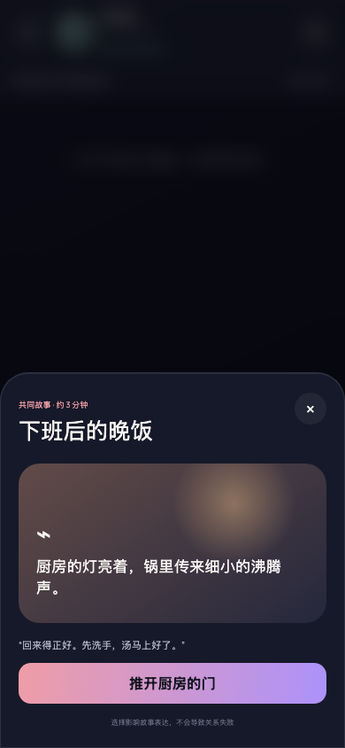
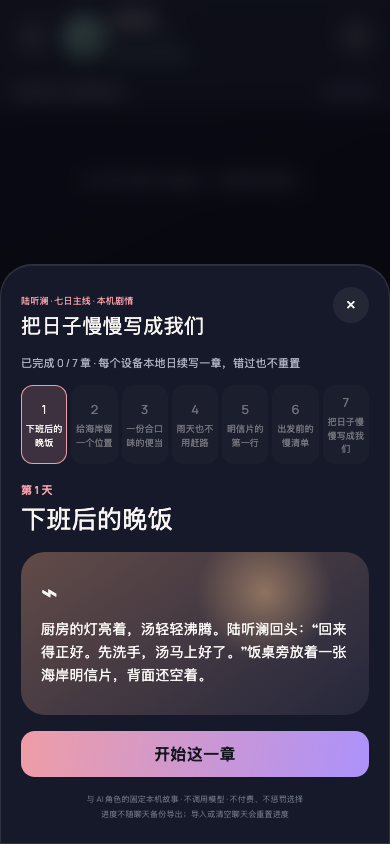

# Seven-day storyline visual verification

## Before

Baseline application revision: `6fc3f97` (before this ticket's UI changes).

Scenario: fresh isolated browser profile → default Lu onboarding → Lu chat → “共同故事”, before making a choice. Viewport **390 × 844**, device scale 1, dark theme, reduced motion, time zone Asia/Shanghai, browser clock 2026-11-04 10:00 local.



## After

Changed application revision: the PR head containing this document and the captures (exact commit identified in the PR description).

Same fresh-profile scenario, viewport, theme and story state as Before.



## Additional verified states

- [Same-day waiting state after reload](after-waiting.png)
- [Day-seven ending](after-finale.png)
- [Day-seven recap, scrolled to the bottom](after-finale-recap.png)
- [Completed mainline at 320 × 740](after-complete-320.png)

Captures come from the running Aily application, not mockups. The browser script completes one chapter on each of seven simulated local calendar dates, reloads progress, revisits the first choice without another save, verifies seven persisted relationship memories, and checks the narrow viewport and browser errors. All data is synthetic in an isolated browser context. No API Key or external model calls are used.

```bash
npm run dev -- --host 127.0.0.1 --port 4191 --strictPort
node scripts/verify-seven-day-story.mjs
# Baseline capture must be run against the baseline application before changing it:
node scripts/verify-seven-day-story.mjs --before
```
