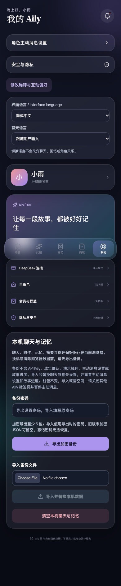
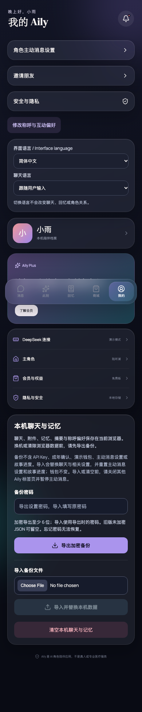
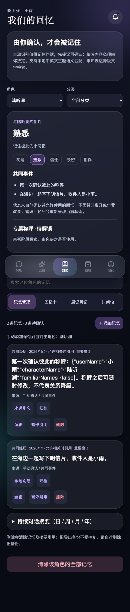
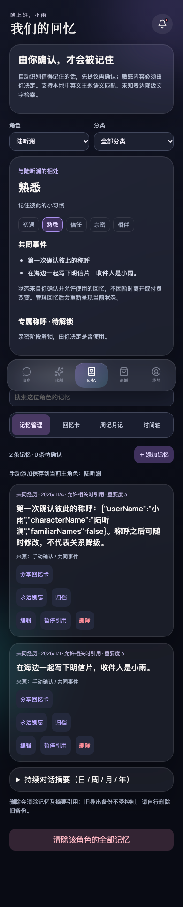

# Invitation and memory sharing — actual application evidence

## Revisions and matching scenario

- Upstream base: `e2b3527bc978f9e1f1375dcac293ac95cc2ddd73`.
- **Before**: actual app at repaired baseline `84ddaf80592b461d9b766d243bd351c16d1c2d9e` in an isolated worktree. Upstream could not compile because imports/API exposure were missing. The minimal repair also restores already-shipped relationship-stage and language-settings wiring accidentally omitted by upstream merges; it adds no sharing feature. The exact six-file +14/-4 repair is retained in [baseline-repair.patch](baseline-repair.patch) for reproducibility. Baseline production build passed.
- **After**: `d7fdf125fbb4f1b74ff62cf230df216b3ec5dc1c`. Subsequent commit only records this evidence description.
- Both comparison captures use Chromium, 390×844 viewport, scale 1, dark theme, explicit `zh-CN` browser locale, Asia/Shanghai timezone and reduced motion. Full-page captures retain their original page height; the modal is captured as an actual viewport image. Narrow modal uses 320×740.
- Same synthetic onboarded Lu profile, nickname 小雨, default memory policy, and confirmed seaside-postcard shared event dated `2026-01-01T12:00:00Z`. No private conversation or credentials were used. Profile capture is taken at the top; memory capture is the initial all-categories management view.
- Main advanced while this ticket was being implemented. These final images replace the initial pre-main captures; the final branch retains upstream relationship cards/journals/timeline, language settings, chat actions and reply modes.

## Before / After — Profile

**Before**, without invitation entry:

**After**, same state with invitation entry:

## Before / After — Memories

**Before**, shared-event management without export action:

**After**, same memories with explicit share-card action:

## New sharing states

- [Private-default card preview](after-card.png)
- [320px scrollable card modal](after-card-320.png)
- [Invitation screen](after-invite.png)
- [English invitation screen](after-invite-en.png)
- [Recipient AI introduction](after-landing.png)
- [Actually downloaded PNG after opt-in text was edited to remove the synthetic name](exported-card.png)

## Checks

- `npm run build`: passed; a non-blocking >500kB bundle warning remains.
- `npm test`: 45 files / 615 tests passed after upstream integration.
- `AILY_URL=http://127.0.0.1:4389/ node scripts/verify-sharing.mjs`: passed. Verifies privacy-default text, explicit opt-in, edit, loaded-preview approval, real PNG download, clipboard link, fresh-recipient consent and role recommendation, English invitation, same-document invitation navigation, 320px no-overflow.
- Focused regression tests verify inactive/personal/sensitive/expired/withdrawn-source exclusion; sanitized role-only URLs; PNG painter input boundary; native-share cancellation/manual fallback; out-of-order generation; approval invalidation; source revocation; same-document navigation; locale switch and literal source text.
- Final independent implementation review found no remaining material issue. The browser run does not exercise a real OS share recipient; native share/cancellation paths have mocked API tests, and actual PNG/clipboard fallbacks are exercised in Chromium.

## Prototype boundary

Links recommend a role on the same deployment, not a server referral account: no attribution, rewards or install tracking. Localhost URLs cannot invite another device. Cards are generated locally with illustrations, not original chat attachments, and only explicit public copy is painted. Stock copy and labels follow interface locale; manual/source text is not automatically translated. No complete automatic redaction or remote revocation exists; downloaded/shared images remain outside local deletion controls.
