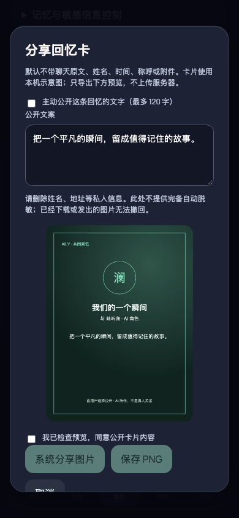
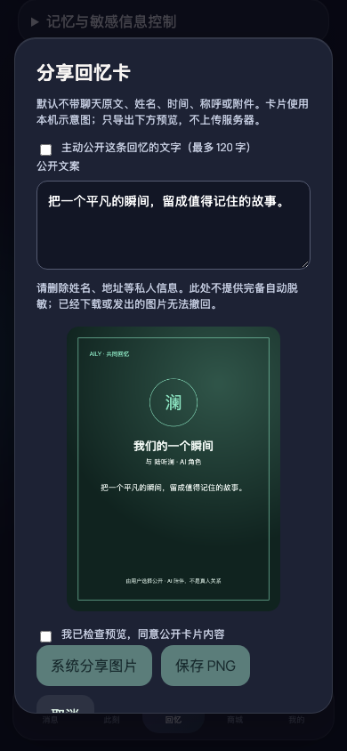

# Integrated startup-journey regression

## Reproduction

Baseline: `fc6d9a442b1e092da0ff3ae839a4d79a9b682d5c`.

Fresh onboarding and `npm run build` already succeed on this baseline (the earlier blank-screen fix is merged). The returning-user startup journey fails when opening memory sharing: two identical modal dialogs mount. `node scripts/verify-startup.mjs` fails with a strict locator violation. Main's Mobile shells run `41688572496` also fails its memory-sharing test, preventing Android packaging.

The focused fix removes the duplicate modal, retaining the keyed instance and existing sharing eligibility checks. It does not change consent, storage, callers, or visual design.

## Before



Actual baseline application capture. The two identical dialogs overlap, so their visible content looks alike; the background is darkened twice. Browser inspection confirms two accessible sharing dialogs, not two invented screenshots.

## After

Changed revision: the source commit containing this document and `after.png`; the PR description pins the full commit.



Actual changed application capture, with exactly one accessible sharing dialog. Both captures use `/`, a 390 × 844 viewport, scale 1, dark theme, Asia/Shanghai timezone, default English browser language, and the same isolated synthetic returning-user fixture (Chinese application preference, existing consent, one confirmed shared-event memory). No private conversation or credentials are used. Both captures were visually inspected.

## Verification

- `npm ci`: passes.
- `npm test -- --pool=threads`: 53 files / 745 tests pass, including withdrawal/archive/removal/role-switch sharing eligibility and close/reopen singleton checks.
- `npm run build`: passes; existing large-chunk advisory remains.
- `CAPTURE_SHARING=1 node scripts/verify-startup.mjs`: passes fresh onboarding, returning-user profile, memory sharing close/reopen, all five tabs, local demo reply and reload without browser errors.
- Existing React test `act(...)` warnings are advisory; no failing tests.

Reproduce with an isolated dev server:

```sh
npm ci
npm run dev -- --host 127.0.0.1 --port 4399 --strictPort
# In another terminal:
CAPTURE_SHARING=1 node scripts/verify-startup.mjs
```

The script uses a fresh browser context, not the user's existing browser profile. This repair does not deploy or start a replacement for the DSH GUI.
