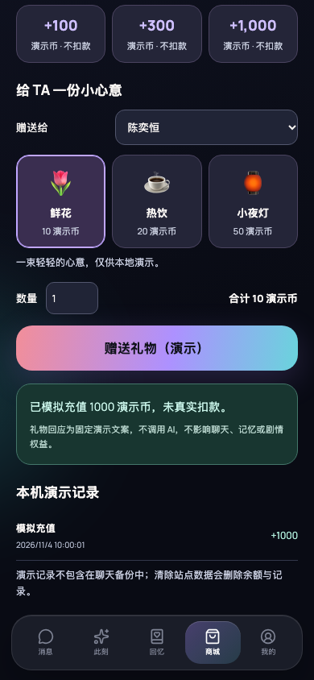
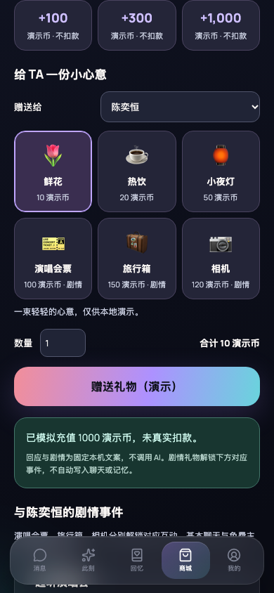

# 剧情礼物：实际应用视觉证据

## 对比场景

使用 Playwright Chromium 的隔离浏览器资料，不读取真实使用记录、API Key 或任何私有聊天。

- 同一场景：完成默认引导，选择陈奕恒，在商城免费补充 1000 演示币，鲜花选中、数量 1，尚未送礼，滚动至礼物目录。
- 同一环境：390 × 844、deviceScaleFactor 1、dark、reduced motion、简体中文、Asia/Shanghai。
- 设备时间固定为测试夹具 `2026-11-04T10:00:00+08:00`。
- Before：`4353d2ddae90a1328421c411375c1409bae90e06` 的实际商城实现，应用共用前置合并修复后运行；不是重绘或假界面。
- After：`602625881904ed96e40c74ae3c695382e56c0db6`；后续提交只更新本验证脚本与证据／说明，不改变应用界面。

## Before



## After



剧情礼物分别解锁演唱会、小旅行与拍照事件。解锁按角色保存，已解锁无需重复赠送。事件可预览选择、确认保存、继续未完成内容和回看已保存结局。

- [选择预览，尚未保存](after-preview.png)
- [确认后回看结局](after-complete.png)
- [320px 中文事件](after-event-320.png)
- [320px 中文事件入口](after-library-320.png)
- [320px 英文事件](after-event-en-320.png)
- [320px 英文事件入口](after-library-en-320.png)

## 基线说明与重现

原始基线包含重复导入、合并遗留的旧界面／未接入的新界面，以及丢失的本地化和完成流处理。为实际启动应用并在相同可用环境比较旧商城，Before 和 After 共用这些前置修复。基线的商城目录、礼物扣币逻辑、钱包与隐私删除仍保持原实现；Before 没有剧情礼物、解锁表或事件界面。

完整共用生产修复见 [baseline-restoration.patch](baseline-restoration.patch)。基线另仅移除了两个测试文件内重复的 `acceptSafetyConsent` 导入以通过 TypeScript 编译；没有更改其测试断言。这里不把修复后的基线声称为原始提交未经修改即可运行。

在独立目录导出上述基线，应用补丁并去掉这两个重复测试导入后，安装依赖并启动：

```bash
npm run dev -- --host 127.0.0.1 --port 14329 --strictPort
# 在本 PR 目录运行：
AILY_URL=http://127.0.0.1:14329 node scripts/verify-story-gifts.mjs --before
```

After 在本 PR 目录启动 `npm run dev -- --host 127.0.0.1 --port 4328 --strictPort`，再运行 `node scripts/verify-story-gifts.mjs`。

浏览器验证覆盖余额不足与取消不扣币、三种礼物分别解锁、预览取消不保存、选择确认与刷新回看不重复扣币、角色隔离、第二标签页同步、320px 无水平溢出，以及中英切换保留选择标识。额外单元测试覆盖旧数据库升级、事务回滚、竞争解锁与结局、存储失败重试及删除本机资料清理事件。

## 使用边界

本次实现的是可实际操作并保存进度的本机商城剧情闭环，不是真实货币支付。演示币无现金价值；没有应用商店支付、服务器验单、线上账户或跨设备权益。剧情为固定虚构文案，非 AI 生成，不自动写入聊天或长期记忆；基本回应和免费主线不需送礼。事件不随聊天备份导出，删除本机资料或站点数据会删除事件。
